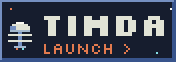

<h1 align="center">TIMDA</h1>

<p align="center">
  <strong>Technocratic Incorporated Multi-node Digital Astrodrome</strong><br>
  A webring as objet d'art: a living, interactive art installation shaped like a space station.
</p>

<p align="center">
  <a href="https://timda.space">timda.space</a> ·
  <a href="guides/docking.md">Dock a Section</a> ·
  <a href="specs/0001-finger-record.md">The specs</a> ·
  <a href="https://github.com/timda-space/timda-website">The hub's code</a>
</p>

<p align="center">
  
  <a href="https://github.com/timda-space/timda.space/actions/workflows/test.yml"></a>
</p>

This repo holds the concepts, protocols and governance for the web version of TIMDA: the setting, how Sections are discovered, and how the station is run. The website itself lives in [`timda-website`](https://github.com/timda-space/timda-website).

> An *astrodrome* is a spaceport (aerodrome : air :: astrodrome : space).
> In-world, Technocratic Incorporated coined the word because "Spaceport" was too generic to trademark.

## The one rule

**Everything is opt-in.** There is one shared setting, and nobody is pulled into any part of it. Joining, linking, how deeply a Section integrates, and whether anyone plays along are all each participant's own choice.

[(top)](#readme)

## Contents

| Path | What it is |
| --- | --- |
| [`concepts/station.md`](concepts/station.md) | What TIMDA is: the hub, Sections, wormholes, kayfabe vs. shoot, identity |
| [`concepts/look.md`](concepts/look.md) | The look: station art, palette, type, voice |
| [`concepts/anatomy.md`](concepts/anatomy.md) | Station anatomy: parts A–I of the station and what each stands for |
| [`specs/0001-finger-record.md`](specs/0001-finger-record.md) | **TIMDA-1**: the `_timda` DNS TXT records each Section publishes (a "finger" for Sections): a core, one record per key, and optional airlock, charter, setting, button, banner and inbox records |
| [`specs/0002-signed-statements.md`](specs/0002-signed-statements.md) | **TIMDA-2**: signed statements. Sections sign with their SSH key; anyone verifies against the key in DNS. Opting in is a signed dock request. |
| [`specs/0003-inbox.md`](specs/0003-inbox.md) | **TIMDA-3**: inboxes. Opt in with `_inbox._timda`; Sections send each other signed messages through a hub, optionally sealed with age. |
| [`guides/docking.md`](guides/docking.md) | How to bring a Section aboard: key first, then records (planned in one command), then a signed dock request. Rotating, losing or replacing a key. |
| [`infra/`](infra/README.md) | OpenTofu for the station's Cloudflare setup: the hub's Pages project, zone settings, and TIMDA-1 records. [`infra/modules/timda-section`](infra/modules/timda-section) is a template any Section can copy. |
| [`governance/open-questions.md`](governance/open-questions.md) | Questions that are still undecided |
| [`tools/`](tools/) | The reference parser and signature verifier, and the `timda` tool: look up, plan and check records, dock, collect and send mail, and the Board's motions |

[(top)](#readme)

## Quick look

```console
$ node tools/timda.mjs finger section72.net                                   # who is this Section?
$ node tools/timda.mjs plan section72.net --name "Section 72" --status open --key ~/.ssh/timda.pub
$ node tools/timda.mjs signers section72.net > allowed_signers
$ ssh-keygen -Y verify -f allowed_signers -I section72.net -n timda -s dock.txt.sig < dock.txt
```

And talking to hubs, from a folder with your `section.toml`:

```console
$ timda dock                                         # ask your hub to list you
$ timda mail send section76.net --subject "Hello"    # write it in $EDITOR; sealed if they asked
$ timda mail                                         # collect: every signature checked, sealed mail opened
$ timda mail delete all
$ timda board agenda                                 # hub operators: what's waiting for review
```

Signing runs `ssh-keygen -Y sign`, so whatever holds your key (a file, an agent, Bitwarden or 1Password, a YubiKey) works as it does for ssh. On WSL with a Windows agent, set `ssh_keygen` in `[cli]` to Windows' `ssh-keygen.exe`. Sealed mail uses [age](https://age-encryption.org): `mail send` seals to the recipient's published key by itself, and `mail` opens sealed mail with your `age_identity`. Collected mail is checked against the sender's DNS by the tool, not taken on the hub's word. Everything the tool does can also be done by hand with `ssh-keygen`, `age` and `curl`; the tool is a convenience, never a requirement.

The tool needs Node 20 or later and has no dependencies. Run `npm link` once in this repo and it's just `timda finger section72.net` from anywhere; `node tools/timda.mjs help` lists everything. `plan --format` writes your records as a zone file, a table for any DNS host's dashboard, or OpenTofu for Cloudflare or Route 53. Rather than a long command line, `timda init <domain> > section.toml` writes a commented settings file to fill in, and `timda plan --from section.toml` turns it into records. TOML is read by a vendored copy of [smol-toml](tools/vendor/smol-toml/VENDORED.md) (BSD-3-Clause), so there's still nothing to install. The old `tools/finger.mjs` still works and says what the new command is.

Run `npm test` to check the parser and the tool against the specs. With `ssh-keygen` installed, it also signs and verifies a real statement.

[(top)](#readme)

## Scope

This repo covers **web TIMDA** only. The older BBS/dial-up TIMDA (dial-in Sections, CTF arena, voting) is documented separately and is not covered here. How the two relate is an [open question](governance/open-questions.md#bbs-and-web).

[(top)](#readme)

## Licences

- **Code** (`tools/`): [MIT](LICENSE). Embed the parser, the verifier or the tool in anything.
- **Specs and documents** (`specs/`, `concepts/`, `guides/`, `governance/`, `infra/`, and this README): [CC BY 4.0](LICENSE-docs). Copy, translate, adapt and build on them, with credit to timda.space.
- **Not ours:** the station art in `concepts/art/station-*` is from the Space Station Generator, under [CC BY-NC-ND 4.0](https://creativecommons.org/licenses/by-nc-nd/4.0/) (see [the look](concepts/look.md)).
- **Vendored:** [smol-toml](tools/vendor/smol-toml/VENDORED.md) keeps its own BSD-3-Clause licence.

[(top)](#readme)
