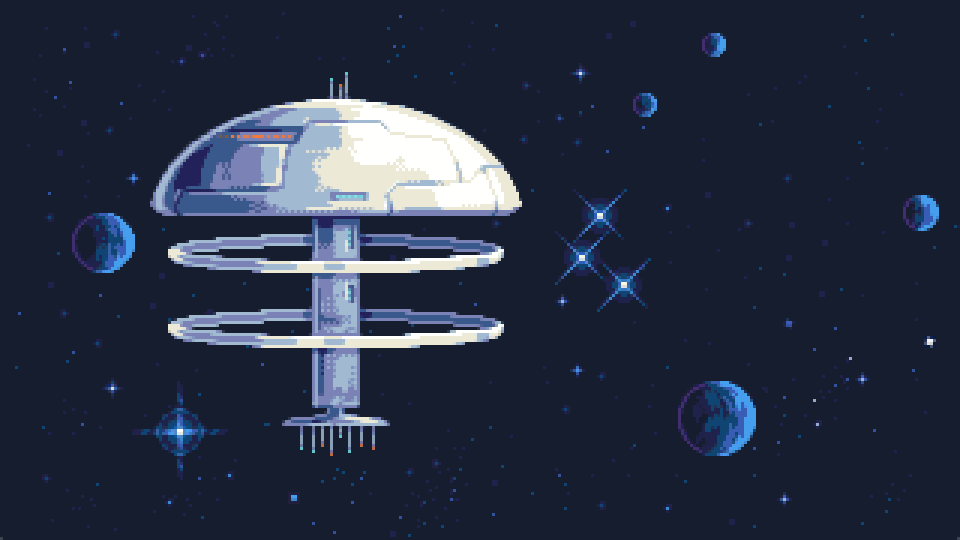

# Station anatomy

**Status: every part is named, and every part but the Ivory Tower and the ComforPods is live on the hub.**

Each lettered part of the [station art](look.md) has **the work**, its in-world name and flavour, and **the shoot**, the real part of TIMDA it stands for, if it has one. 

The parts run from the mast at the top (A) down through the dome, the rings and the spine to the pods hanging under the disk (I).

## The parts

### A. EconoPod Mast-er Suites

> **EconoPod Mast-er Suites:** a combination communication matrix and CozyCocoon economy issue mandated sleep pods.

- **Part:** the mast, the two antennae on top of the dome.
- **The work:** the station's communication matrix, which relays messages and listens for beacons, sharing the mast with the mandatory CozyCocoon economy sleep pods.
- **The shoot:** two jobs:
  - **The Wormhole Post:** signed mail between Sections ([TIMDA-3](../specs/0003-inbox.md)), held at the hub until it's collected, sealed with age if the recipient asks.
  - **The beacon listener:** the hub checks a Section's `_timda` records whenever it lists or routes to it, reusing each check for no longer than the records' TTL, and lights or darkens its berth to match.

### B. Executive Suites and HyperMall

> **Technocratic Incorporated Executive Suites** and the **EconoMatic HyperMall**.

- **Part:** the dome, the station's main hull.
- **The work:** the company's executive suites share the dome with the EconoMatic HyperMall.
- **The shoot:** the HyperMall is the Section directory, with each approved Section a storefront. The Executive Suites are the Board: where the hub's operator approves, delists and reinstates Sections with signed resolutions.

### C. Great Ideas Observation Lounge

> **Great Ideas Observation Lounge** (Now with AuthentiGlass\*)
>
> \*AuthentiGlass is not, in fact, glass. It's BETTER.

- **Part:** the dark window panel on the dome, with the orange light strip.
- **The work:** the station's observation lounge, looking out through AuthentiGlass™.
- **The shoot:** the banner showcase: opt-in 468×60 banners from open Sections, rotating, with captions ([TIMDA-1 §6.2](../specs/0001-finger-record.md)).

### D. Deep Thoughts Station Arrivals

> **Deep Thoughts Station Arrivals** and the **Keep-on-Living PaySupport** system. *50% off on recycled air credits!*

- **Part:** the cyan panel light at the base of the dome.
- **The work:** where every traveller arrives, next to the station's pay-as-you-breathe life support. Recycled air credits are currently half price.
- **The shoot:** Arrivals is the front page, with the Arrivals board (and its feed) announcing who docks, changes status and leaves of `timda.space`, where visitors land. Keep-on-Living PaySupport is the infrastructure that keeps the station running (hosting, DNS, the record checks) and, if it's ever needed, how its costs get covered.

### E. Department of Aggressive Positivity

- **Part:** the upper ring.
- **The work:** Technocratic Incorporated's marketing division.
- **The shoot:** promotional material for Sections that want it, such as 88×31 buttons, banners and link-back snippets. Using it is opt-in, like everything else.

### F. Research & Development

- **Part:** the lower ring.
- **The work:** Technocratic Incorporated's R&D division.
- **The shoot:** the specs and tools: TIMDA-1 to 3, the `timda` tool, and the rest of this repo.

### G. The Ivory Tower

- **Part:** the spine.
- **The work:** a luxury living resort running up the station's core, home to the company's finest. It's the opposite end of the market from the EconoPods on the mast.
- **The shoot (proposed, to confirm):** Sections that live on TIMDA proper (`*.timda.space`) instead of their own domains: the station's residents. "Luxury" is the Department of Aggressive Positivity talking. In reality, living on TIMDA proper is no better than docking from your own domain, and there are no tiers.

### H. InstaSafe Rapid Crew Detachment Detonation Disk

- **Part:** the bottom platform.
- **The work:** the station's emergency escape: the whole disk detaches, rapidly and safely. The word "detonation" is reassuring, according to Marketing.
- **The shoot (proposed, to confirm):** the opt-out. Any Section can undock at once, with nobody's permission, by switching off its beacon (removing its `_timda` record). The hub drops it at the next check.

### I. ComforPod "Reasonable Rest" Cost-Conscious Habitation Pods

> *"Our employees, almost as good as credits."*

- **Part:** the prongs hanging under the disk.
- **The work:** budget habitation for the workforce, one pod per prong.
- **The shoot (proposed, to confirm):** travellers' keys. A traveller who has a key but no domain gets a pod: an entry in the key directory.

## Set dressing

The planets and stars around the station are scenery. They don't stand for anything.

## Words for the setting

These are proposed and not yet decided. They work alongside the spec's own terms and don't replace them.

| In-world | Means |
| --- | --- |
| **Beacon** | A Section's `_timda` TXT record. "Light your beacon" means publish it. "Go dark" means remove it or set `status=closed`. |
| **Lit / dark berth** | A Section with `status=open` / `status=closed`, or one that has disappeared. |
| **Docking** | Getting listed: being in the registry, approved by the Board, with a beacon lit. |
| **Undocking** | Leaving, which only takes switching the beacon off. Nobody has to ask anyone. |
