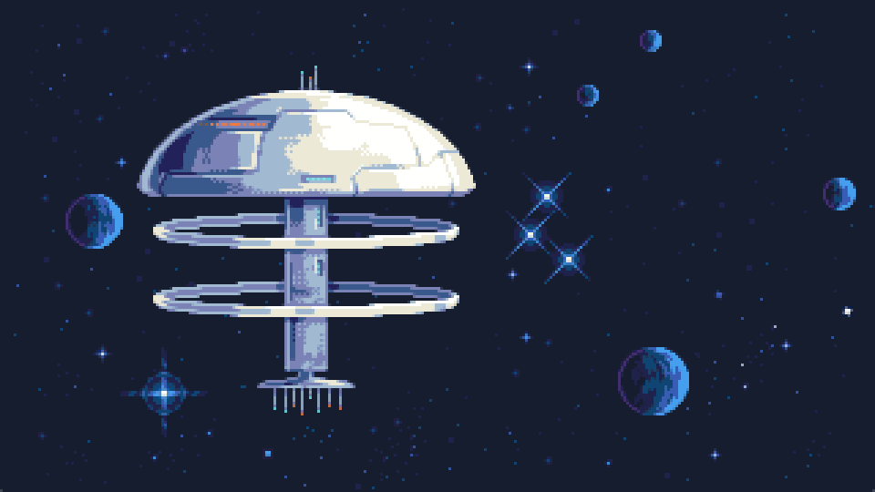
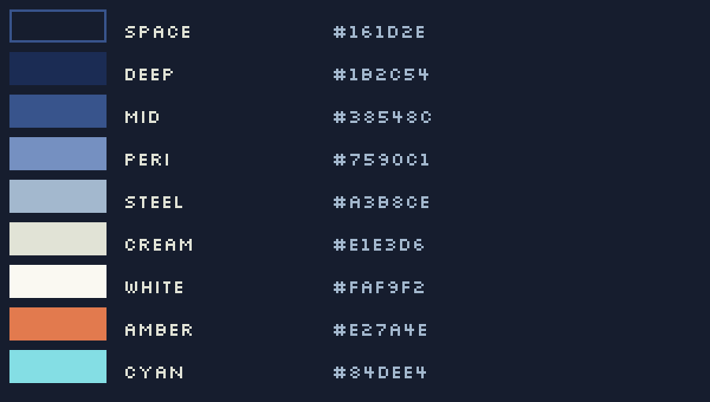

# The look

This is the reference for how TIMDA looks. The hub site follows it, and Sections are welcome to borrow from it. Like everything else in TIMDA, using it is optional.

## The station

The station's portrait is pixel art: a white dome on a central spine, two rings around the spine, and an antenna array underneath, floating in deep navy space among blue planets and four-point stars.

| File | Size | Use |
| --- | --- | --- |
| [`art/station-320x180.png`](art/station-320x180.png) | 320×180 | The station art. |
| [`art/station-titled-320x200.png`](art/station-titled-320x200.png) | 320×200 | The art extended by 20 rows of starfield, with the full name lettered in. **A modification: internal use only** (see the licence below). |
| `art/*-preview-3x.png` | 3× | Pre-scaled copies for viewing on GitHub. Don't build from these. |

### Rules for the art

- **Scale by whole numbers only,** using nearest-neighbour (`image-rendering: pixelated` in CSS). Never smooth, blur or resample it.
- **Use one art pixel as the unit.** Anything drawn into the art, lettering included, sits on the same grid.
- **Keep the source at its native size.** Make any larger copy from the source, not from another copy.

### Where it came from, and the licence

The station was made with the **[Space Station Generator](https://uselesspursuit.itch.io/space-station-generator)** by Useless Pursuit: art by Norma2D, programming by Michael Gojuro. The generator is licensed **[CC BY-NC-ND 4.0](https://creativecommons.org/licenses/by-nc-nd/4.0/)**. Since the image is built from Norma2D's art, we treat it as covered by the same licence:

- **Attribution:** credit Useless Pursuit, Norma2D and Michael Gojuro, and link the licence, wherever the art appears.
- **NonCommercial:** TIMDA can't use this art for anything commercial.
- **NoDerivatives:** the image may be shared as it is, but not in a modified form. Scaling it up whole is fine, but extending, recolouring or drawing on it isn't. So this repo carries only the unmodified image (`station-320x180.png`, and `station-preview-3x.png`, the same scaled up whole). Titled or labelled versions are modifications, and aren't published.

The files here were recovered from a screenshot of the generated image (3 screen pixels per art pixel, sampled back to 320×180, near-duplicate colours merged). Re-exporting from the generator (press Space in the Windows version; the file is saved to Documents) would replace it with the real thing.

## Palette

Nine core colours, all sampled from the station art:

| Token | Hex | Role |
| --- | --- | --- |
| `space` | `#161d2e` | Background: the art's empty space |
| `deep` | `#1b2c54` | Planet shadow, panels |
| `mid` | `#38548c` | Borders, title shadow |
| `peri` | `#7590c1` | Hull shading, labels |
| `steel` | `#a3b8ce` | Secondary text, lettering in the art |
| `cream` | `#e1e3d6` | Hull, body text |
| `white` | `#faf9f2` | Highlights, headings |
| `amber` | `#e27a4e` | The dome's window lights; section headings |
| `cyan` | `#84dee4` | The dome's panel light; links |

Palette files for pixel editors such as Aseprite and GIMP:

- [`art/timda-core.gpl`](art/timda-core.gpl): the nine core colours.
- [`art/station-full.gpl`](art/station-full.gpl): every colour in the titled art, most-used first.

### Status colours

Wherever a Section's status is shown (the HyperMall, `finger`, the station status), it uses these:

| Status | Colour | Token |
| --- | --- | --- |
| `open` | `#84dee4` | `cyan`: the station's live light |
| `closed` | `#e27a4e` | `amber`: there, but dark |
| `pending` | `#7590c1` | `peri`: not lit yet |

TIMDA is dark only: it's set in space.

## Type

| Font | Use | Notes |
| --- | --- | --- |
| **Silkscreen** | Titles, headings, lettering in the art | A pixel font on an 8-pixel grid: at 8px, one font pixel is one screen pixel. Capitals are 5 pixels tall. Use it in uppercase, regular weight, with a little letter-spacing, at a multiple of 8px (headings are 24px) so its pixels stay crisp. The big "TIMDA" title is the one bold exception. |
| **JetBrains Mono** | Body text | Clean and readable at any size or display scaling. |
| **Space Mono** | Secondary text: directory entries, fine print, footers | Retro-futurist. Pairs with JetBrains Mono without competing with it. |
| **Space Grotesk** | Bold uppercase labels: readout rows, directory decks | Space Mono's proportional sibling. Monospaced capitals space unevenly (a narrow "I" gets a full cell), so labels use this instead, bold, with a little letter-spacing. |

All four are under the SIL Open Font License. Sites serve them from their own domain rather than from a font CDN, so visitors' browsers don't contact a third party.

**Lettering in the art:** set Silkscreen at 8px, so one font pixel is one art pixel. Add 1px of letter-spacing, colour it `steel`, and give it a 1px shadow down and to the right in `deep`. Lettering this small is unreadable when the art is shown under about 2× scale, so smaller screens should show the name as ordinary text instead.

### Why not VT323

The hub first used VT323 for body text. It imitates a bitmap terminal font on a grid of 25 pixels per em, with bevelled "pixels". It only renders cleanly when that grid lands exactly on screen pixels: at 25px, at 100% display scaling, with no browser zoom. Anywhere else, the strokes come out uneven and look rough. So it's out.

## Voice

The in-world voice belongs to Technocratic Incorporated: polite, corporate and slightly too pleased with itself ("Technocratic Incorporated thanks you for choosing digital transit"). Out-of-character text is plain and direct, and always labelled as such. See [kayfabe vs. shoot](station.md#kayfabe-vs-shoot).
